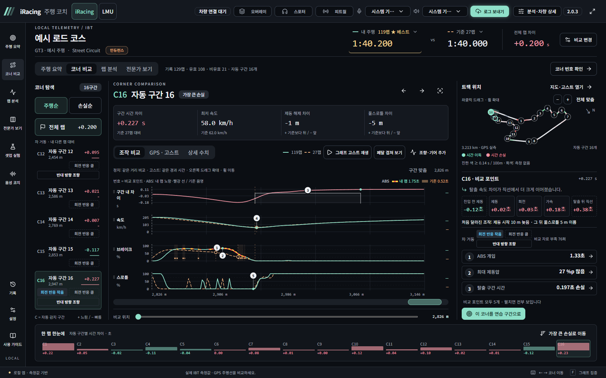
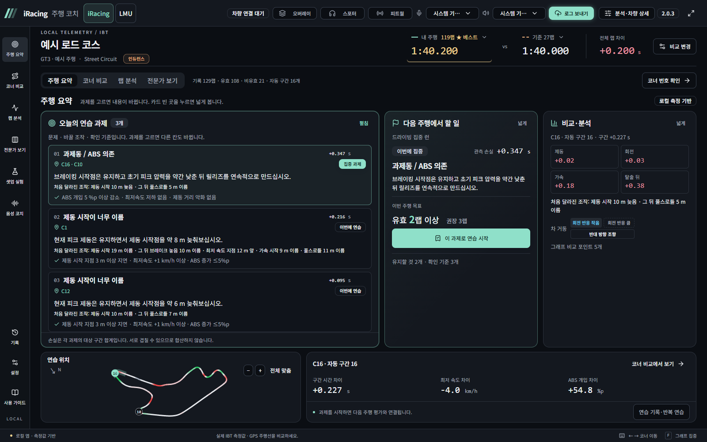
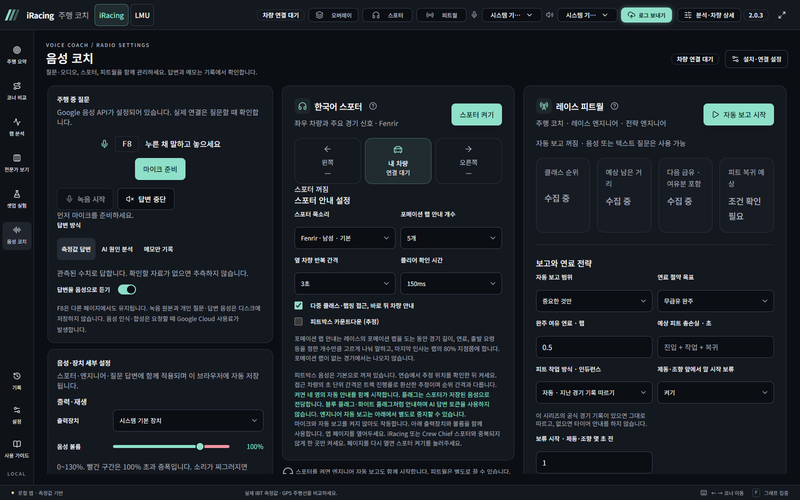
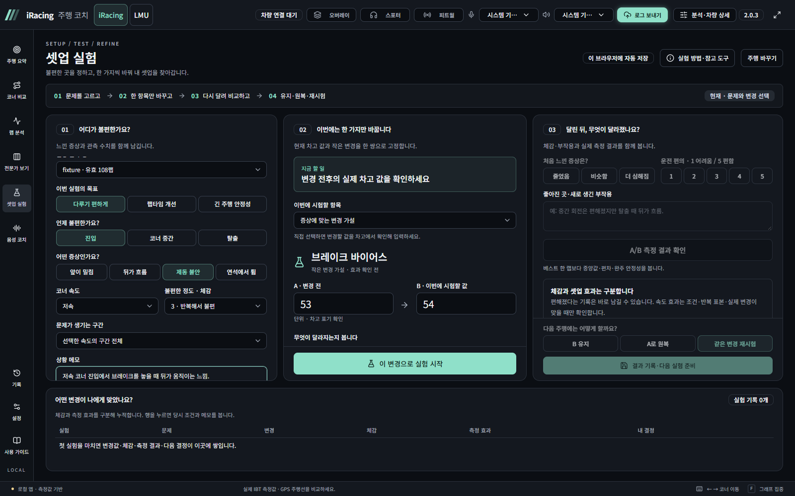

<h1 align="center">iRacing 주행 코치</h1>

<strong>달린 기록을 살펴보고, 다음 주행에서 바꿀 한 가지를 찾으세요.</strong>

iRacing과 Le Mans Ultimate의 주행 기록을 분석하고 한국어 스포터·피트월·음성 질문으로 주행을 돕는 Windows 로컬 앱입니다.

<a href="https://github.com/elsalvadoruk-hue/racingcoach/releases/latest"><strong>최신 버전 다운로드</strong></a> &nbsp;·&nbsp; <a href="#getting-started">빠른 시작</a> &nbsp;·&nbsp; <a href="https://github.com/elsalvadoruk-hue/racingcoach/releases">업데이트 내역</a>

Windows x64 &nbsp; / &nbsp; iRacing · Le Mans Ultimate &nbsp; / &nbsp; 개인·비상업적 사용 무료

<h2>주행 전후를 잇는 세 가지 기능</h2>

<table>
<tr><th width="33%">주행 후 분석</th><th width="34%">주행 중 지원</th><th width="33%">연습과 셋업</th></tr>
<tr><td>랩·코너별 시간 차이 지도·고스트·조작 그래프 내 랩 / Garage61 기준 비교</td><td>한국어 좌우 차량 스포터 연료·순위·피트월 보고 F8 음성 질문과 주행 메모</td><td>오늘의 연습 과제 다음 주행 결과 확인 한 항목씩 바꾸는 셋업 A/B</td></tr>
</table>

Garage61 기준 비교와 셋업 실험은 iRacing에서 지원합니다. LMU의 상세 지원 범위는 아래 표를 확인하세요.

<h2>01 &nbsp; 어느 코너에서 시간을 잃었는지</h2>

내 랩과 기준 랩을 같은 거리에서 비교합니다. 지도와 브레이크·스로틀·속도 그래프를 함께 보며, 제동 시작부터 탈출까지 차이가 생긴 지점을 확인하세요.

<strong>랩·코너 비교</strong> &nbsp;·&nbsp; <strong>GPS 주행선·고스트</strong> &nbsp;·&nbsp; <strong>브레이크·스로틀·조향 분석</strong>

<h2>02 &nbsp; 다음 주행에서 바꿀 한 가지</h2>

분석 결과를 연습 과제로 정리합니다. 집중할 구간과 바꿀 조작, 확인할 기준을 고르고 다시 달린 뒤 같은 구간의 결과를 확인할 수 있습니다.

<strong>우선순위가 있는 연습 과제</strong> &nbsp;·&nbsp; <strong>구간 반복 연습</strong> &nbsp;·&nbsp; <strong>다음 주행 피드백</strong>

<h2>03 &nbsp; 주행 중에는 한국어 안내로</h2>

좌우 차량과 주요 경기 상황은 스포터가, 연료·순위·피트 정보는 피트월이 알려 줍니다. F8을 누른 채 질문하거나 주행 중 느낀 점을 메모로 남길 수 있습니다.

<strong>한국어 스포터</strong> &nbsp;·&nbsp; <strong>레이스·전략 엔지니어</strong> &nbsp;·&nbsp; <strong>F8 질문·메모</strong> &nbsp;·&nbsp; <strong>주행 오버레이</strong>

받아 둔 고정 음성 안내는 Google 키 없이 사용할 수 있습니다. 마이크 질문·AI 답변·새 문장 합성에는 본인의 Google Cloud 설정이 필요합니다.

<h2>04 &nbsp; 셋업은 한 항목씩, 효과는 A/B로</h2>

불편한 구간과 증상을 고르고 한 항목만 바꿔 다시 달립니다. 체감과 실제 측정 결과를 함께 남기며, 조건이 맞는 주행끼리 페이스·일관성·완주 안정성을 비교합니다.

<strong>현재값과 변경값 기록</strong> &nbsp;·&nbsp; <strong>단일 변경 비교</strong> &nbsp;·&nbsp; <strong>유지·원복·재시험 이력</strong>

<blockquote>
스크린샷은 예시 데이터를 사용한 2.1.0 화면입니다. 공개 버전의 변경 내용은 <a href="https://github.com/elsalvadoruk-hue/racingcoach/releases">Releases</a>를 확인하세요.
</blockquote>

<h2>지원 게임</h2>

<table>
<tr><th>기능</th><th>iRacing</th><th>Le Mans Ultimate</th></tr>
<tr><td>주행 기록 분석</td><td>IBT</td><td>DuckDB 기록</td></tr>
<tr><td>스포터·피트월·음성 질문</td><td>지원</td><td>지원</td></tr>
<tr><td>Garage61 기준 비교</td><td>지원</td><td>—</td></tr>
<tr><td>셋업 A/B 실험</td><td>지원</td><td>준비 중</td></tr>
</table>

<h2>설치와 첫 실행</h2>

Windows x64에서 사용합니다. 처음 설치용 ZIP에는 Python과 화면 빌드가 포함돼 있어 Python·Node.js·PATH를 따로 설정할 필요가 없습니다.

<ol>
<li><a href="https://github.com/elsalvadoruk-hue/racingcoach/releases/latest"><strong>최신 Releases</strong></a>에서 <code>racingcoach-setup-*.zip</code>을 받아 압축을 풉니다.</li>
<li><code>설치.bat</code>을 한 번 실행한 뒤 <code>실행.bat</code>으로 앱을 켭니다. 최초 설치에는 인터넷이 필요합니다.</li>
<li>업데이트 창의 <strong>빠진 음성 받기</strong>로 고정 안내 음성을 받습니다. 첫 다운로드는 약 0.66GB입니다.</li>
<li><strong>설정 → 설치 설정</strong>에서 게임의 주행 기록 폴더를 지정합니다. Google Cloud·Garage61은 사용할 기능에 맞춰 연결합니다.</li>
</ol>

화면 주소는 <strong>http://localhost:24157</strong>을 사용하세요. 평소에는 <code>실행.bat</code>만 실행하고, 함께 열린 실행 창은 유지합니다.

최신 사용법은 앱 왼쪽 아래 <strong>사용 가이드</strong>에서 확인하세요. <a href="https://github.com/elsalvadoruk-hue/racingcoach/raw/refs/heads/main/manual/매뉴얼.html">오프라인 HTML 매뉴얼</a>은 이전 1.3.0 화면 기준의 참고 자료입니다.

<h2>업데이트</h2>

앱 시작 시 새 버전이 있으면 업데이트 창에서 <strong>업데이트 받기 → 지금 다시 시작해서 적용</strong>을 선택합니다. 기존 기록·설정·키·토큰·음성은 보존됩니다.

켜 둔 동안 나온 업데이트와 추가 음성은 <strong>설정 → 업데이트</strong>에서 확인할 수 있습니다. 업데이트 창은 주행 중에 자동으로 뜨지 않습니다.

이전 버전에서 옮기기 · 음성을 직접 받기 · 소스로 실행하기

구버전의 수동 이전과 음성 다운로드 문제는 <a href="manual/설치-상세-안내.md">설치 상세 안내</a>와 앱의 <strong>사용 가이드</strong>를 참고하세요. 개인 데이터 폴더는 삭제하지 마세요.

개발용 소스에는 내장 Python과 화면 빌드가 포함되지 않습니다. Python 3.12와 Node.js LTS 환경에서 <code>설치.bat</code>을 실행합니다. 검증 명령과 구조는 <a href="manual/개발-안내.md">개발 안내</a>를 확인하세요.

<h2>서비스 비용과 데이터</h2>

<ul>
<li><strong>기본 분석과 고정 안내:</strong> 로컬 주행 분석과 받아 둔 고정 음성은 Google 키 없이 사용할 수 있습니다. 자동 보고·스포터는 AI를 호출하지 않습니다.</li>
<li><strong>선택 서비스:</strong> 마이크 음성 인식·AI 답변·새 문장 합성은 본인의 Google Cloud를 사용하며 비용이 발생할 수 있습니다. Garage61 수집에는 본인 토큰이 필요합니다.</li>
<li><strong>주행과 개인정보:</strong> SDK는 읽기 전용입니다. 측정값이 없으면 추측하지 않습니다. 녹음 원음과 개인 질문·AI 답변 음성은 디스크에 저장하지 않습니다.</li>
<li><strong>로그 보내기:</strong> 자동 전송은 사용자가 동의해 켰을 때 동작합니다. 전송 항목을 확인하고 앱에서 사용 여부를 선택할 수 있습니다.</li>
</ul>

<h2>저작권과 이용조건</h2>

<strong>개인·비상업적 사용은 무료입니다.</strong> 본인 사용을 위한 백업·로컬 수정·빌드를 허용합니다. 소스가 공개돼 있어도 MIT 등 자유 재배포 라이선스가 적용되는 것은 아닙니다.

프로그램·소스·문서·음성팩의 재배포·재업로드·판매 및 다른 제품에 포함하는 행위는 사전 서면 허락이 필요합니다. 소개할 때는 공식 저장소 링크를 공유해 주세요. 외부 라이브러리·폰트·지도·상표의 권리는 각 권리자에게 있습니다.

Copyright © 2026 iRacing 주행 코치 제작자. &nbsp; <a href="https://github.com/elsalvadoruk-hue/racingcoach/blob/main/LICENSE.md">전체 이용조건</a> · <a href="https://github.com/elsalvadoruk-hue/racingcoach/issues">문의·문제 제보</a>

<a href="https://github.com/elsalvadoruk-hue/racingcoach/releases/latest">다운로드</a> &nbsp;·&nbsp; <a href="#getting-started">빠른 시작</a> &nbsp;·&nbsp; <a href="https://github.com/elsalvadoruk-hue/racingcoach/releases">변경 내역</a> &nbsp;·&nbsp; <a href="https://github.com/elsalvadoruk-hue/racingcoach/issues">문의</a>

