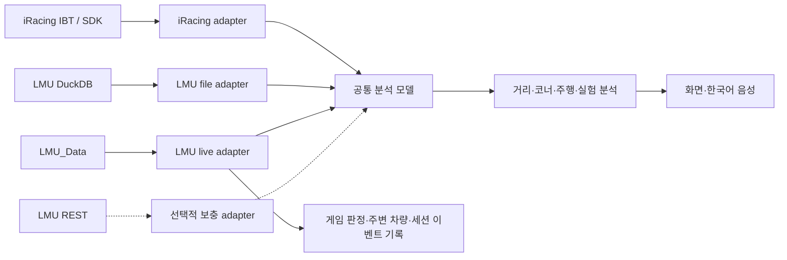

# LMU에서 기존 iRacing 분석 기능을 제공하기 위한 개발 요구사항

조사일: 2026-10-20. 대상은 이 저장소의 **iRacing 주행 코치 기능**이며, iRacing 게임 자체의 기능 전체를 복제하는 범위는 아닙니다.

**랩 비교·트랙 지도·코너 분석·주행 코칭·음성·실시간 보고는 LMU에서도 구현할 근거가 있습니다.** 핵심은 LMU 입력을 공통 분석 모델로 변환하고, 차량·트랙·유효성·셋업의 의미를 검증하는 것입니다. 기존 iRacing 코드를 그대로 연결하거나 채널 이름만 바꾸는 것으로는 충분하지 않습니다. Garage61 기준 랩 자동 수집과 차종별 셋업 처방까지 동일하게 제공할 수 있는지는 별도 과제입니다.

현재 동작하는 LMU 기능은 파일·랩 진단, 단일 랩 상대 경로·제동/고스로틀 측정, 파일 간 수동 비교·거리 구간 통계, 다중 랩 오프라인 고스트입니다. 기존 제동 계산 모듈을 연결해 평균 감속과 속도별 시간도 제공합니다. 명시적 시작/중지, 기록 상한, 별도 JSONL, 랩 판정 신호 상태기계를 갖춘 실시간 진단 수집도 로컬 구현했습니다. 실제 게임 연결·화면 대조는 아직 완료하지 않았으며 최초 게임 build 호환성은 `UNVERIFIED_INSTALLED_SDK_ONLY`, 실시간 공개 유효성은 `valid=None` / `GAME_SCREEN_UNVERIFIED`입니다. 기존 Monza 랩의 유효성은 `VALIDITY_UNVERIFIED`를 유지합니다. 아래 설계와 완료 조건에는 아직 구현·실주행 검증이 남은 범위가 포함됩니다.

## 최신 구현 상태: 차량 관측과 연습 과제

연습 과제의 로컬 저장·고정 경계 재비교·비교 이력까지 구현했습니다. 사용자의 새 실주행 전후 검증은 집에서 이어가기로 했으며 현재는 추가 주행을 요청하지 않습니다. 기존 파일만으로 타이어·차고·서스펜션·휠 속도·연료/에너지·엔진/브레이크 24개 채널의 scalar/4성분 시간축 그래프와 원본 표본 통계도 구현했습니다. 휠 순서·적정 온도/압력·셋업 효과는 미확인으로 유지합니다.

실제 5개 랩에서 120개 채널 응답의 통계 1,035개와 표시점 99,772개를 원본 표본과 대조했습니다. 최신 검증은 LMU Python184/UI22이며 화면은 **http://127.0.0.1:24174/**입니다. 아래 조사 당시의 단계 표·예상 요구사항과 최신 구현 근거를 구분해야 합니다. 상세 이력과 제한은 [개발 기록](lmu-development.md)의 최신 두 항목에 있습니다.

## 판단을 바꾸는 확인 사항

| 확인 사항 | 근거 | 개발에 미치는 영향 |
| --- | --- | --- |
| DuckDB 기록은 게임의 공식 기능 | 공식 Telemetry Recording 안내 [S1] | 별도 MoTeC 변환기를 필수로 둘 필요 없음 |
| 기록 채널·주파수는 설정 가능 | 공식 안내의 `UserData/Telemetry/config.json` [S1] | 현재 파일의 66개 채널이 LMU 전체 제공 범위는 아님 |
| 내장 shared memory와 게임 제공 헤더가 있음 | 공식 업데이트 [S2][S3], 설치 파일 [L1] | 실시간 수집은 내장 인터페이스를 우선 사용 |
| 랩 무효·랩 집계·트랙 리밋 신호가 헤더에 있음 | `mLapInvalidated`, `mCountLapFlag`, `mTrackLimitsSteps` [L2] | 앞으로 기록하는 세션의 컷 유효성 검증 경로가 있음. 과거 파일의 유효성 복원은 보장되지 않음 |
| 실제 Monza 파일에 셋업 JSON이 있음 | `CarSetup`, 38,011문자, 172개 항목 [L3] | 셋업 데이터 전체 부재가 아니라 해석·정규화·분석 연결이 미구현인 상태 |
| 공식 안내에 현재 파일에 없는 채널도 있음 | `Yaw Rate`, `Steered Angle`, `Drag`, `FrontDownForce` 등 [S1] | 실제 지원·단위·차종별 값과 기록 설정을 시험해야 함 |
| Garage61 소개는 iRacing 중심으로 명시 | 서비스 자체 소개 [S5] | 기존 Garage61 수집 경로의 LMU 지원을 전제할 수 없음 |
| LMU용 외부 비교 서비스·공개 분석기가 있음 | Popometer [S6], MyLMU [S7], LMU Telemetry Lab [S8] | 비교·지도·고스트의 구현 사례는 있음. 외부 데이터 다운로드/API 권리는 별도 확인 |

설치된 `config.json`에는 위 `Yaw Rate`·`Steered Angle`·공력 채널이 없었습니다. 공식 문서 예제를 추가하면 반드시 기록된다고 확정할 수는 없습니다. 예제에 `ReadDownForce`, `Brake Tickness` 같은 표기도 있어, 이름을 추측해 일괄 추가하지 않고 소량 기록 후 실제 테이블·단위를 확인해야 합니다. 이번 조사에서는 설정을 변경하지 않았습니다.

## 기능별 필요한 작업

| 기존 기능 | LMU 구현 판단 | 추가로 필요한 것 | 완료 판단 기준 |
| --- | --- | --- | --- |
| 랩 시간·목록·피트 랩 구분 | 현재 일부 동작 | 게임 무효 신호와 랩 종료 확정 연결 | 정상·컷·아웃·인·중단 랩이 게임 표시와 일치 |
| 여러 랩 그래프·델타·다른 세션 비교 | 우선 구현 가능 | 파일 간 선택, 공통 모델, 조건 필터, 결측 처리 | 혼합 주파수·기록 시작 시각이 달라도 손실 구간 보존 |
| 트랙 지도·고스트·주행 라인 비교 | 위치 데이터로 구현 가능 | GPS 투영, 거리 원점·방향, 레이아웃 식별, 위치 품질 검사 | 겹친 경로와 시작선이 맞고 순간이동·피트 경로를 구분 |
| 자동 코너 분할·코너별 손실 | 기하·속도·페달로 구현 가능 | 고정 코너 경계, 시케인 처리, 제동/재가속 adapter | 여러 랩에서 같은 코너 ID와 구간을 사용 |
| 코너 이름·음성 이름 | 별도 지도 데이터 필요 | 레이아웃별 출처 있는 번호·명칭 또는 사용자 확인 | 잘못된 레이아웃에 다른 코너 이름이 붙지 않음 |
| 제동 지점·트레일 브레이킹·가속 지점 | 현재 데이터로 측정 가능 | 페달 0~1 정규화, 시간축, 필터 전후 구분 | 원본 그래프·독립 계산과 일치하며 결측을 0으로 보지 않음 |
| 일관성·오늘의 과제·반복 연습 | 분석 결과를 바탕으로 가능 | 여러 랩 이력, 비교 조건, 코칭 규칙, 연습 결과 저장 | 측정 사실·가설을 구분하고 근거 있는 구간을 지목 |
| 타이어·차고·서스펜션·공력 | 부분 데이터가 있으나 차량별 검증 필요 | 휠 순서·단위·측정 위치·차종별 정상 범위 | 데이터 미지원과 실제 0을 구분하고 잘못된 수식을 차단 |
| 셋업 표시·변경 비교·A/B 실험 | 실제 셋업 JSON을 활용할 수 있음 | `VM_*` 해석기, 차량별 조절 항목, 실험 저장소 | 화면 실제 값과 일치하고 단일 변경·반복 결과를 추적 |
| 자동 셋업 추천 | 별도 모델·실험 근거 필요 | 차량/타이어/BoP별 근거, 운전자 일관성·조건 통제 | 반복 검증된 효과만 제안하고 상충 결과를 보존 |
| 외부 빠른 기준 랩 | 수동 파일 방식부터 가능 | LMU 파일 간 비교, 출처·조건·사용권·유효성 | 같은 차종·레이아웃이며 출처와 조건이 명확 |
| 실시간 스포터·플래그·격차 보고 | shared memory로 개발 가능 | 주변 차량 상태, 좌표 변환, 최신성, 멀티클래스 규칙 | AI/온라인에서 추월·중첩·재접속·ID 재사용을 검증 |
| 연료·피트·레이스 전략 | LMU 전용 규칙 필요 | 연료와 Virtual Energy 분리, 소비 추정, 피트 시간·규정 | 실제 스틴트·피트 결과와 추정 오차를 비교 |
| 한국어 음성·질문·브리핑 | 기존 자산의 재사용 후보 | LMU 상태와 질문 응답 연결, 우선순위·취소·유효기간 | 오래된 보고를 재생하지 않고 데이터 미확인을 설명 |

코너의 공식 이름이 없어도 검증된 기하 구간을 `구간 1`처럼 표시해 분석할 수 있습니다. 공식 이름과 번호는 별도 확인 후 붙이면 됩니다. 컷 유효성이 미확인인 랩도 명시적으로 선택해 관측값을 비교할 수 있지만, 유효 베스트 랩 자동 선정에 넣어서는 안 됩니다.

## 권장 구조와 재사용 범위

기존 `analysis_numeric.py`의 수치 처리, `corner_measurements.py`의 구간 측정, 코너 비교·반복 분석의 계산 부분은 재사용 후보입니다. `analysis_routes.py`, LMU route, 저장소와 UI는 adapter 결과를 받도록 연결해야 합니다. 현재 `TelemetryAnalyzer`는 `backend_api.py`에 있어 애플리케이션 전역 객체와 iRacing 상태 의존성을 분리하는 작업도 필요합니다.

현재 `ParsedTelemetry`는 단일 `tick_rate`, IBT 헤더·offset, iRacing `session_info`를 전제하고 `LapSegment.valid`는 `bool`입니다. 반면 LMU는 채널별 주파수와 이벤트가 다르고 유효성이 미확인일 수 있습니다. **LMU를 억지로 IBT 객체처럼 포장하는 대신, 필요한 분석 입력만 공통 모델로 분리**하는 편이 안전합니다. `valid=null`을 `True`로 바꿔 기존 필터를 통과시키지 않습니다.

공통 모델에는 다음 정보를 둡니다.

- 출처: 게임, 파일 해시·기록 ID, schema version, 확인된 게임 build, 수집 경로.
- 차량·트랙: 차량 모델, 클래스, 연식/변형, 트랙·레이아웃, 방향, 검증된 트랙 길이·시작선. iRacing 숫자 ID를 LMU에 재사용하지 않음.
- 채널: 값·시간축·단위·주파수·scalar/휠 배열 형태, 필터 전후, 결측/미지원 mask, 보간 방식.
- 랩: 경계·공식 시간·분석 가능 여부, 피트 여부, `True / False / null` 유효성, 판정 출처·시각·연결 신뢰도.
- 세션: 날씨·노면·연료·Virtual Energy·SoC·타이어·셋업 fingerprint, 조건의 확인 여부.
- 분석 결과: 관측값·비교 범위·추정/가설·지원 가능한 기능 목록. 미지원은 `null`과 사유로 표현.

랩 유효성과 데이터 품질은 독립적입니다. 게임에서 무효인 랩도 데이터는 연속일 수 있고, 유효 랩도 기록 누락 때문에 분석 불가능할 수 있습니다.

## 데이터 정규화에서 먼저 해결할 문제

| 항목 | 필요한 처리 |
| --- | --- |
| 속도 | `Ground Speed`와 `GPS Speed`의 의미·단위를 파일별 확인. m/s ↔ km/h를 변환하되 두 채널을 동일 신호로 가정하지 않음 |
| 페달 | 단위가 `%`인지 0~1인지 확인. 실제 운전자 입력과 TC/리미터 등으로 조정된 filtered 값을 구분 |
| 조향 | `Steering Pos` 비율을 `SteeringWheelAngle` rad로 이름만 바꾸지 않음. physical/visual steering range와 도로 바퀴 각도를 구분하고 각도 근거가 없으면 비율로만 분석 |
| 가속도·회전 | DuckDB의 G Force와 shared memory m/s²를 구분. LMU의 왼손 좌표계·좌우/전후/yaw 부호를 공통 좌표계로 변환 |
| 시간·거리 | 현재 10/50/100 Hz를 유지하고 각 채널의 시간축에서 정렬. 일정 Hz로 늘려도 정보 정밀도가 늘었다고 해석하지 않음 |
| 이벤트 | `Gear`, `ABS`, 피트/섹터 상태 등은 시각 기준 계단형 복원. 중간 값 선형 보간 금지 |
| 공식 섹터 | 현재 250/500/1000 m 구간과 구별. `Current Sector` 변경 시각을 거리에 연결하고 누적 Sector2 시간인지 확인 |
| 휠 배열 | LF/RF/LR/RR 순서와 각 열 구조를 검증. 타이어 left/centre/right 온도는 자동으로 inside/middle/outside가 되지 않음 |
| 온도·압력 | shared memory 헤더의 타이어 온도 Kelvin, 압력 kPa와 저장 파일의 unit을 별도 취급 |
| 차고·서스펜션 | m/mm, 전후 axle 값과 각 휠 값, spring deflection과 ride height의 측정 위치를 구분 |
| 셋업 | `value` 정수가 조절 단계일 수 있음. `stringValue`, `available`, 범위와 게임 화면을 대조해 물리량으로 해석 |

기존 검증 영수증의 이름 불일치 30개에는 원시 SDK 이름 23개와 `_coverage`, `time_s` 등 내부/파생 키 7개가 섞여 있습니다. 이것을 “LMU에 필요한 센서 30개가 없다”는 뜻으로 사용하면 안 됩니다. 기능별 의미·단위·가용성 표로 바꿔야 합니다.

## 실시간 수집과 랩 유효성

설치 게임의 `Support/SharedMemoryInterface`에서 `LMU_Data`, `LMU_Data_HoldEvent`, `LMU_Data_DataEvent`, `SharedMemoryLock`, `gameVersion`을 확인했습니다 [L1]. 헤더는 update gate 대기 → lock → snapshot copy → unlock 후 처리를 예시로 제공합니다. 단순한 mmap polling을 그대로 붙이면 동시에 갱신되는 데이터가 섞일 수 있습니다. 공개 Python mapping [S4]은 참고 후보이며 설치 버전의 ABI·동기화 계약과 대조해야 합니다.

수집기 구현·검증 기준은 다음과 같습니다.

1. 게임이 만든 mapping과 event를 열고, 게임이 없을 때 빈 mapping을 만들어 연결 성공으로 오인하지 않기.
2. x64 크기·필드 offset·packing·104대 배열·버전을 확인하고 불일치 시 수집 중단. 헤더 정의의 존재와 실제 채널 가용성을 별도 검사.
3. lock 안에서는 필요한 데이터를 신속히 복사하고 해제. 분석·네트워크·음성 처리는 복사한 snapshot에서 수행.
4. telemetry/scoring 각각의 시각·갱신 이벤트를 추적. 메뉴·일시정지·리플레이·세션 변경·게임 종료·재접속 시 오래된 값을 폐기.
5. 주변 차량은 vehicle ID와 세션을 함께 사용. `mID` 재사용과 driver swap을 고려하고 원격 차량 신호 가용성은 실제 온라인에서 확인.
6. 원시 이벤트·유효성·타임스탬프를 별도 로컬 기록에 남겨 저장 DuckDB와 나중에 결합. 게임 제어 값은 변경하지 않으며 필요한 동기화 절차는 지킴.

`mLapInvalidated`는 현재 랩의 무효 신호 후보, `mCountLapFlag`는 lap/time 집계 정책, `mTrackLimitsSteps`는 트랙 리밋 누적 상태입니다. `mNumPenalties`는 미이행 패널티 수여서 특정 랩의 컷 판정이나 패널티 종류·남은 시간을 모두 설명하지 않습니다 [L2]. **한 신호를 단독으로 해석해 유효성을 확정하지 않습니다.**

랩 시작부터 종료 후 scoring 갱신까지 관측하고 `mLastLapTime`, `mTotalLaps`, `mLapStartET`와 연결해야 합니다. 무효 신호가 언제 초기화되는지, 다음 랩까지 영향이 있는지, scoring 지연이 어느 정도인지 게임 표시와 대조합니다. 중간 접속·수집 누락·판정 충돌은 `null`로 유지합니다.

현재 Monza 파일의 38개 이벤트에는 위 유효성 신호가 없습니다. 이 두 랩을 다음 주행의 판정으로 소급 보정하지 않습니다. `Track Edge`와 `SurfaceTypes`로 자체 이탈 진단을 만들 수는 있으나, 게임의 컷 판정과 같은 것으로 취급하지 않습니다.

2026-10-20 구현 업데이트: `lmu_shared_memory.py`/`lmu_native_bridge.cpp`, `lmu_live.py`, `lmu_validity.py`와 `/api/lmu/live/status`, `/api/lmu/live/start`, `/api/lmu/live/stop`을 연결했습니다. 상태 조회만으로 attach하지 않고 사용자의 명시적 시작 뒤 별도 로컬 JSONL에 승인된 수치·이벤트와 관측 근거를 기록합니다. 수집당 상한은 900초·100000프레임·128 MiB이며 원본 DuckDB·게임 설정·SDK 헤더는 수정하지 않습니다. driver name·SteamID·셋업/SDK struct 원문은 저장·응답에서 제외합니다. SDK/header/source/DLL fingerprint와 배열 길이 검사, 기존 mapping/event만 열기, bounded lock 획득과 RAII 해제, 세션/차량/시계 변화에 따른 cache 분리를 구현했습니다. raw `gameVersion`이 양수가 아니거나 연결 중 바뀌면 중단합니다.

이 보호 장치가 최초 실행 build의 ABI 호환성을 승인하지는 않습니다. 최초 build는 `UNVERIFIED_INSTALLED_SDK_ONLY`이고, 부재/lifecycle 변화를 관측하지 못한 같은 ID/model 재사용의 식별 한계도 남습니다. 정상 신호 일치 후보 `CONSISTENT_VALID_SIGNALS`, 시간 집계 제한 신호 `COUNT_POLICY_SIGNAL_OBSERVED`, 명시적 랩 무효 신호 관측 `INVALID_SIGNAL_OBSERVED`, 불완전 관측 `UNKNOWN`은 진단 enum이며 `valid=True/False`로 자동 승격하지 않습니다. Monza / GT3 `2:05.798` 정상 인정 사례에서 실제 연결·기록 시간 일치와 사용자 게임 표시 대조를 한 번 확인했습니다. 그 랩의 일시적인 `count_lap_flag=1`을 최종 무효로 해석하지 않도록 분리했으며 컷/무효 사례는 추가 대조가 필요합니다. native fixture·합성 서비스/API/UI 검증과 실제 게임/온라인 검증을 구분합니다. 상세 구현과 최소 실주행 절차는 [개발 기록](lmu-development.md), [실시간 검증 안내](lmu-live-validation.md)에 있습니다.

## 셋업과 차량 분석

현재 `CarSetup`은 172개 `VM_*` 항목의 JSON이며 `available`, `value`, `stringValue`, `minValue`, `maxValue` 등의 필드가 있습니다 [L3]. 172개가 모두 사용 가능한 조절 항목이라는 뜻은 아닙니다. 저장 시점의 셋업과 실제 주행 중 변경값의 관계도 확인해야 합니다.

먼저 셋업 표시와 변경 비교를 구현합니다. 그 뒤 단일 항목 A/B 실험을 붙여 연료·타이어 준비·노면·날씨·교통·운전자 일관성을 통제하고 반복 결과를 저장합니다. 두 랩의 기록 차이만으로 셋업 효과나 필요한 조절 방향을 확정할 수 없습니다. 기존 `analysis_setup.py`, `analysis_vehicle.py`, `setup_profiles.py`의 iRacing 차종별 임계치와 처방은 LMU용 근거 없이 재사용하지 않습니다.

타이어·차고·서스펜션의 그래프와 관측 통계는 처방보다 먼저 제공할 수 있습니다. 공력 균형·언더스티어 원인·타이어 적정 온도 같은 해석은 차량별 측정 의미와 기준을 검증한 뒤 활성화합니다. Virtual Energy, 실제 연료, 하이브리드 SoC는 별도 값으로 관리합니다.

공개 TinyPedal 소스에는 `/rest/garage/getPlayerGarageData`, `/rest/garage/UIScreen/RepairAndRefuel`, `/rest/sessions/weather`, `/rest/strategy/pitstop-estimate`를 읽는 구현이 있습니다 [S9]. 셋업·수리·예보 보충 경로의 후보지만, 공개적으로 보장된 안정 API라는 근거는 확인하지 못했습니다. 실제 지원·버전·부하·응답을 검증하기 전에는 필수 의존성으로 삼지 않습니다.

## 외부 기준 랩과 배포 조건

**첫 외부 기준 랩 기능은 사용자가 제공한 LMU DuckDB의 수동 비교가 적절합니다.** 같은 차종·연식/변형·레이아웃·방향을 확인하고, 연료·타이어·날씨·노면·BoP/게임 build·셋업 조건을 함께 표시합니다. 현재 파일의 `CarName`은 팀/엔트리 이름이고 `CarClass`는 GT3이므로 이 두 값만으로 같은 차량 모델이라고 확정하지 않습니다. shared memory의 `mVehicleModel`, `mVehFilename` 등과 검증된 차량 목록을 연결할 필요가 있습니다.

Garage61은 자체 소개에서 iRacing 중심이라고 명시합니다 [S5]. LMU 지원 API·기준 랩 공급 계약은 확인하지 못했습니다. Popometer는 LMU에서 자신·다른 운전자와 비교할 수 있다고 명시하지만, 안내는 별도 플러그인 설치 방식이며 현재 게임 build의 동작과 외부 다운로드/API 허용 여부는 별도 확인이 필요합니다 [S6]. MyLMU도 DuckDB 업로드·공유·리더보드를 안내하지만 우리 앱으로 가져오는 API 권리가 자동으로 생기지는 않습니다 [S7].

| 자료/코드 | 확인한 조건 | 적용 방향 |
| --- | --- | --- |
| 게임 제공 `SharedMemoryInterface.hpp` | 지원 제품 확장 개발용, 헤더 재배포·수정 금지 명시 [L1] | 원본 헤더를 저장소·배포물에 복사하지 않고 로컬 SDK 사용 방식 검토 |
| `pyLMUSharedMemory` | MIT [S4] | 라이선스 고지와 ABI 검증을 전제로 수집 adapter 후보 |
| TinyPedal 본체·REST adapter | GPL-3.0 [S9] | MIT인 별도 mapping과 혼동하지 않기. 직접 코드 통합 전 배포 조건 검토 |
| `oasis4/LMU-telemetry` | 비상업적 사용 조건 [S10] | 무조건 재사용 가능한 소스로 취급하지 않기 |
| LMU Telemetry Lab | MIT 라이선스·지도/고스트/세션 비교 기능 명시 [S8] | 개별 코드·자산의 출처와 정확성을 확인한 뒤 참고 |
| 타인 주행·유료 기준 데이터·지도 이미지·음성 | 공급자별 조건 | 이용권·공유 범위를 확인하고 SteamID·운전자 정보·셋업을 기본 외부 전송하지 않기 |

## 권장 개발 순서와 검증 자료

2026-10-20 최신 진행: 기준 랩 좌표에서 기하 굴곡 후보를 만들고 같은 거리 경계를 다른 랩에도 적용하는 비교를 추가했습니다. 기존 4개 랩에서 6개 후보와 입력 관측 위치를 대조했으며, 수동 선택 3~6개 랩의 제동·탈출 입력 위치 분포를 우선 표시합니다. 이는 아래 3단계의 관측 분석 부분입니다. 공식 코너명/지도·게임 유효성·환경 동등성·반복 실험이나 연습 이력 저장을 완료했다는 뜻은 아닙니다. 사용자는 시간 손실보다 입력 반복성을 우선하도록 선택했습니다. 최신 화면은 **http://127.0.0.1:24171/**이며 구체적인 사용법과 LMU153/UI16 검증은 [개발 기록](lmu-development.md)의 최신 항목에 있습니다. 추가 주행 없이 현재 파일로 기능 검증을 완료했고, 새 수신 지연 필드와 통제된 반복성 과제는 이후 자연스러운 주행에서 대조합니다.

조사 후 공통 입력 모델·단일 랩 상대 경로·제동/고스로틀 측정에 이어, 파일 간 수동 비교·두 랩 경로와 2~6개 랩의 오프라인 고스트 재생을 구현했습니다. `analysis_bridge.py`로 기존 `CornerMeasurements`의 제동 계산을 연결했으며 실제 네 랩의 제동 구간 55개와 속도별 시간 682개를 대조했습니다. 실시간 진단 수집과 랩 신호 관측도 로컬 구현했으며 범위와 근거는 [개발 기록](lmu-development.md)의 최신 항목에 있습니다. 기존 iRacing analyzer 전체 공통화, 실시간 게임/화면 검증과 게임 유효성 확정은 아직 남아 있습니다. 비교 조건은 메타데이터 일치까지만 확인했으며 게임 유효성·차량 모델 ID·방향·셋업/환경 동일성을 확정하지 않습니다.

| 단계 | 구현 범위 | 필요한 실제 자료 | 완료 조건 |
| --- | --- | --- | --- |
| 1 | 공통 모델, 채널 지원표, 페달/제동 adapter, 지도·다중 랩·파일 간 비교 | 현재 Monza 파일 + 같은 차량/레이아웃의 다른 세션 | 단위·방향·시간 정렬 검증, 결측/피트 구간 분리, 기존 iRacing 회귀 없음 |
| 2 | 내장 shared-memory 진단 수집·별도 이벤트 기록·랩 신호 상태기계 로컬 구현. 실주행 검증 대기 | 우선 정상 timed lap 한 번과 게임 화면 대조, 다음 컷 표시·피트·중단/재접속 순서로 확대 | 게임 판정과 랩 연결 일치. 모호한 경우 `null`. 종료·다시 연결해도 오래된 보고 없음 |
| 3 | 코너 경계 고정, 코너 비교·일관성, 과제·연습 이력 | 같은 조건 여러 랩, 코너 지도 검증 | 다른 주행 속도에서도 경계 안정, 측정값 근거와 코칭 연결 |
| 4 | 실시간 한국어 보고·음성 질문, 스포터·격차·피트 전략 | AI 다중 차량 → 온라인, 플래그·피트·멀티클래스 세션 | 실제 주변 차량과 일치, 경고 지연/누락 측정, 오래된 음성 취소 |
| 5 | 셋업 표시/차이 → A/B → 차종별 제한적 추천, 외부 서비스 연동 | 동일 조건 반복 스틴트, 단일 셋업 변경, 이용 가능한 외부 기준 | 화면 셋업 값 일치, 실험 추적·반증 가능, 공급자 권한·조건 확인 |

2단계는 1단계와 독립된 모듈로 개발할 수 있지만, 유효성 자동 판정 기능은 실제 주행 검증 후에 활성화합니다. 초기에는 Monza와 현재 GT3 차량에 범위를 한정하고, 두 번째 트랙·다른 GT3·Hypercar 순으로 확장하는 편이 검증 부담을 줄입니다.

당장의 실시간 연결 확인은 [최소 실주행 절차](lmu-live-validation.md)에 따라 정상 timed lap 한 번부터 시작합니다. 연결과 랩 경계 대조가 확인되면 컷 표시·피트·중단/재접속을 순서대로 추가합니다. 이후 일관성·셋업·레이스 기능 확장용 자료의 출발점은 정상 timed lap 5개 이상, 컷/인·아웃 랩 사례, 단일 셋업 변경 전후 각 3개 이상의 안정 랩, 짧은 AI 레이스입니다. 이는 통계적 신뢰성을 보장하는 표본 수가 아닙니다. 타이어 마모·인듀런스 전략 검증에는 더 긴 스틴트가 필요하며 현재 네 timed lap만으로 일관성·셋업 처방·실전 전략을 검증할 수 없습니다.

완료 여부는 기능 수의 비율보다 기능별 증거로 판단합니다. 저장 파일 fixture 시험, 실시간 replay 시험, 게임 화면 대조, 온라인 운용 검증을 구분합니다. 일정은 최소 수집 adapter와 차량·트랙 한 쌍을 실제 검증한 뒤 산정하는 것이 적절합니다.

## 출처

| ID | 유형 | URL 또는 설치 파일 | 이 자료가 뒷받침하는 범위 |
| --- | --- | --- | --- |
| S1 | LMU 공식 지원 문서 | [Telemetry Recording](https://guide.lemansultimate.com/hc/en-gb/articles/14524956311695-Telemetry-Recording) | 내장 DuckDB 기록, 자동/수동 시작, 채널·주파수 설정. 형식 변환은 Studio 397 직접 지원 대상이 아님 |
| S2 | LMU 공식 릴리스 노트 | [V1.2 Update 2](https://guide.lemansultimate.com/hc/en-gb/articles/14556121957775-V1-2-Update-2) | shared-memory 헤더 배포와 DuckDB 기록 도입 |
| S3 | LMU 공식 발표 | [V1.3 업데이트](https://lemansultimate.com/le-mans-ultimate-releases-v1-3-update-with-final-elms-content-performance-updates/) | shared memory의 추가 telemetry parameter 발표 |
| S4 | 비공식 공개 Python 구현·라이선스 | [pyLMUSharedMemory 고정 버전](https://github.com/TinyPedal/pyLMUSharedMemory/tree/6a8dd8311d76291d602e020f059b8baae3d518a5), [License.txt](https://github.com/TinyPedal/pyLMUSharedMemory/blob/6a8dd8311d76291d602e020f059b8baae3d518a5/License.txt) | 게임 내장 인터페이스의 mapping 사례. 우리 앱의 실시간 동작 검증을 대신하지 않음 |
| S5 | Garage61 자체 소개 | [About](https://garage61.net/about) | “Garage 61 currently focuses on the iRacing platform.” 브라우저 렌더링 본문 확인 |
| S6 | Popometer 자체 안내 | [LMU 설치·지원 안내](https://popometer.io/p/le-mans-ultimate-release) | LMU 기록·타인과 비교 지원 표명. 플러그인 방식의 과거 안내이므로 현재 build 호환은 별도 |
| S7 | MyLMU 자체 문서 | [Documentation](https://mylmu.app/docs) | 제3자 서비스의 DuckDB 업로드·공유·리더보드·셋업 관리 안내 |
| S8 | 비공식 공개 분석기 | [LMU Telemetry Lab](https://github.com/rabbit20031225/LMU-Telemetry-Lab), [LICENSE](https://github.com/rabbit20031225/LMU-Telemetry-Lab/blob/main/LICENSE) | 지도·고스트·세션 간 비교 구현 사례와 MIT 표기. README 기능 주장을 독립 실행 검증한 것은 아님 |
| S9 | 비공식 공개 연동 소스 | [TinyPedal LMU REST adapter](https://github.com/TinyPedal/TinyPedal/blob/master/tinypedal/adapter/lmu_restapi.py) | REST 보충 경로의 구현 사례. 공식 안정 API 보장을 뜻하지 않음 |
| S10 | 비공식 공개 분석기 라이선스 | [oasis4 LICENSE 고정 버전](https://github.com/oasis4/LMU-telemetry/blob/2c81e3645410b33bfff4037fa28b077ea0a3654e/LICENSE) | 비상업적 사용 제한 |
| S11 | LMU 공식 도메인의 커뮤니티 글 | [Shared memory data structure](https://community.lemansultimate.com/index.php?threads/shared-memory-data-structure.16608/) | 2026-04-02 moderator가 설치 헤더 경로 안내. 커뮤니티 댓글 전체를 공식 API 계약으로 보지 않음 |
| L1 | 설치 게임의 공식 헤더 | `C:\Program Files (x86)\Steam\steamapps\common\Le Mans Ultimate\Support\SharedMemoryInterface\SharedMemoryInterface.hpp` | 라이선스 1–13행, update/lock 예제 38–78행, 구조 269–307행 |
| L2 | 설치 게임의 공식 헤더 | 같은 폴더의 `InternalsPlugin.hpp` | 좌표/단위, `mLapInvalidated` 302행, `mTrackLimitsSteps` 324행, 패널티 429행, `mCountLapFlag` 469행 |
| L3 | 사용자 실제 파일의 읽기 전용 검사 | `Autodromo Nazionale Monza_P_2026-10-20T02_30_41Z.duckdb` | 66개 채널·38개 이벤트·CarSetup JSON 구조. 개인 설정 값은 이 문서에 복사하지 않음 |

설치 Steam build ID는 `25661166`입니다. DuckDB metadata의 `Version=1`을 게임 버전이라고 해석하지 않습니다. L1 SHA256은 `a82833d5e9e277a7c3af8802518e35ea62f4ec7c7c7c9083650282e4edf1f8bf`, L2는 `9b6ee8cf610fa5049b18df580a9a9bc9ebb91346fc466584d576a6442abcf68f`입니다. 게임 업데이트 뒤에는 헤더와 ABI를 다시 확인해야 합니다.

공개 자료 조회 기록은 Git 제외 경로 `logs/lmu-parity-research-20261020/sources.json`, 실제 파일·설정·헤더의 확인 결과는 같은 폴더의 `local-evidence.json`에 있습니다. 원본 주행 파일은 읽기 전후 SHA256이 같고 WAL은 생성되지 않았습니다. Garage61은 JavaScript 렌더링 뒤 본문을 확인했으며 단순 HTTP 응답은 앱 shell이므로 HTTP 200만으로 지원 기능을 판정하지 않았습니다. SimHub의 시도한 문서 URL은 wiki 홈으로 redirect되어 LMU 지원 범위의 확정 근거에서 제외했습니다. 검색 결과·오래된 플러그인 안내는 발견 경로로만 사용했습니다.
